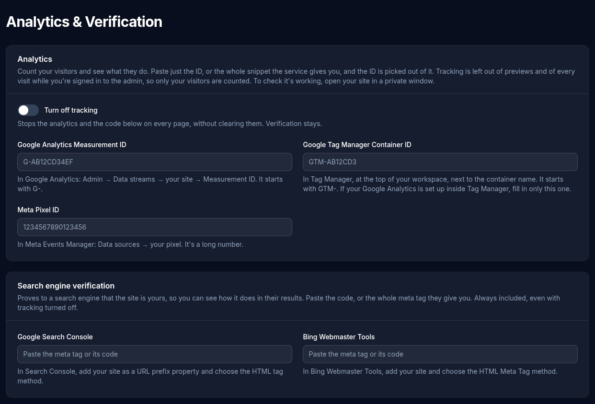

# Analytics & Verification

The **Analytics** screen adds visitor tracking and search engine verification to every page of the site. Nothing is added until you fill something in.

For the common services you only need an ID. Paste just the ID, or the whole snippet the service gives you, and the CMS picks the ID out of it. After saving, the box shows the ID it found. If what you pasted has no ID in it, saving says so.

## Analytics

- **Google Analytics Measurement ID**: in Google Analytics, **Admin → Data streams → your site → Measurement ID**. It starts with `G-`.
- **Google Tag Manager Container ID**: at the top of your Tag Manager workspace, next to the container name. It starts with `GTM-`. If your Google Analytics is set up inside Tag Manager, fill in only this one, or each visit is counted twice.
- **Meta Pixel ID**: in Meta Events Manager, **Data sources → your pixel**. It's a long number.

### Who is tracked

Only your visitors. Tracking is left out of:

- every visit while you're signed in to the admin, since that's most likely you testing
- previews of drafts and scheduled pages

So to check that tracking works, open your site in a private (incognito) window, then look for the visit in the service's real-time report.

The "page not found" page is tracked, so broken links show up in your analytics.

**Turn off tracking** stops all of it, including the code boxes below, without clearing anything. Switch it back on to carry on as before. Search engine verification stays either way.

## Search engine verification

Proves to a search engine that the site is yours, so you can see how it does in their results. Paste the code, or the whole `<meta>` tag they give you.

- **Google Search Console**: add your site as a **URL prefix** property and choose the **HTML tag** method.
- **Bing Webmaster Tools**: add your site and choose the **HTML Meta Tag** method. (Bing can also import your site from Search Console instead.)

Keep the code saved after verifying; the search engines check it again from time to time.

## Other services

For Plausible, Fathom, Matomo and similar services, paste the snippet they give you into one of the two boxes, wherever their instructions say:

- **Head code** goes at the end of every page's `<head>`. This is where most services ask for their code.
- **Footer code** goes at the very end of every page, just before `</body>`. Some services, such as chat widgets, ask for it there.

The code runs on every page exactly as pasted, so only paste code from a service you trust. If a page looks or works wrong afterwards, empty the box and save. Like the services above, this code is left out while you're signed in and from previews.
