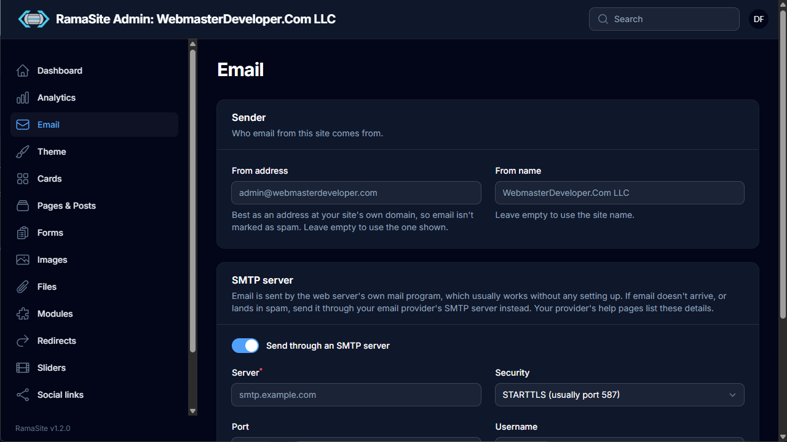

# Email

The site sends email for form submissions, password reset links and two-step login codes. It works without any setting up: by default it uses the web server's own mail sending. An SMTP server is only needed if email isn't getting through, or is landing in spam.

## Sender

- **From address**: who email comes from. Use an address at your site's domain. Left empty, it's `noreply@` your domain.
- **From name**: left empty, it's the site name from the Theme screen.

## SMTP server

Switch on **Send through an SMTP server** to send through your email provider instead, and fill in the details your provider gives you:

- **Server**, such as `mail.example.com`
- **Security**: **STARTTLS** (usually port 587) or **SSL/TLS** (usually port 465)
- **Port**: leave empty for the usual one
- **Username** and **Password**. The password is stored encrypted; once saved, leave the box empty to keep it.

## If the settings have changed

If the settings have changed since you opened the screen, in another browser tab or by another admin, saving stops and asks what to do. **Load the latest settings** discards what you've changed on this screen. **Save my version anyway** replaces everything with what's on this screen; if you were sending a test email, send it again afterwards.

## Test email

**Save and send a test email** saves the settings, then sends a message to your own email address and says whether it worked. If it couldn't be sent, the message explains why.

If a form's email fails to send, the submission is still kept, and the form's submissions list shows it wasn't emailed.
