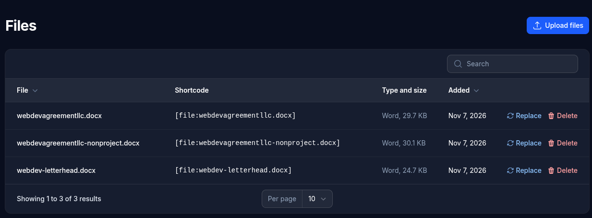

# Files

The file library holds files that pages link to, such as a PDF menu, a price list, a form to fill in or a ZIP of documents.

## Adding files

- Click **Upload files** and drop in one or more files.
- **Insert file**, above each content editor, can upload one while you write (see [Writing content](writing-content.md#files)). It's added to the library too.

These types can be uploaded: PDF, Word, Excel, PowerPoint, OpenDocument (text, spreadsheet and presentation), plain text, CSV and ZIP.

Other types are refused, including web pages, SVG and XML files, and scripts. Files are shown straight from your site's own address, so a web page in the library could pose as part of your site. Each file is also checked inside, so a file renamed to look like an allowed type is refused too.

Names are tidied up (lowercase, no spaces). A name that's already taken gets a number added (`menu-2.pdf`), so an upload never replaces an existing file.

The admin takes files up to 12 MB, and your host may set a lower limit (some allow only 2 MB). A host's limit can usually be raised in the PHP settings of your hosting control panel.

## Audio and video

Recordings and videos aren't kept in the library: they're usually too large for a host's upload limit, and would make every backup much larger. Put them on a service made for them and link or embed from there:

- **Video**: upload it to YouTube and place it with the [YouTube shortcode](writing-content.md#youtube-videos).
- **Audio**, such as an interview or a podcast: upload it to an audio service (such as SoundCloud, the Internet Archive or a podcast host) and link to its page with an ordinary link, `[Listen to the interview](https://...)`.

If you'd rather keep a large file on your own hosting, upload it by FTP or your host's file manager into the CMS's own `public` subfolder, such as `public/media/interview.mp3`, and link to it as `/media/interview.mp3`. It won't be in the library or in the CMS's backups, so keep your own copy.

## Linking to a file

Each file's **shortcode** is shown in the list, such as `[file:menu.pdf]`; click it to copy it. See [Writing content](writing-content.md#files) for the link's text and showing the file's type and size. Click a file's name to open it.

## Replacing a file

**Replace** on a file swaps in a new file and keeps its name, so every link to it gets the new one, and links showing the type and size show the new size. The old file is overwritten and can only be brought back from a [backup](backup.md).

The new file must be the same type: a PDF can only be replaced by a PDF. To use a different type, upload it as a new file.

Visitors get the new file straight away, because the file's address gains a version (`menu.pdf?v=1730600000`).

## Deleting

A file that's linked from a page, post, card or module can't be deleted. The message says where it's used, so you can remove the link there first.
