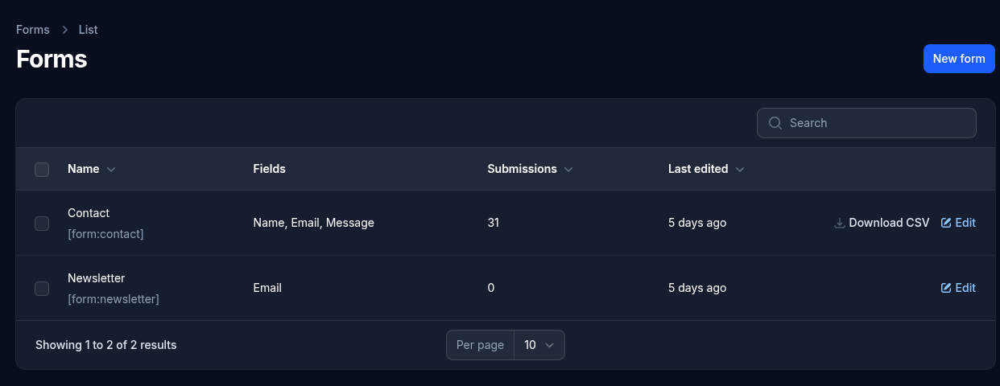
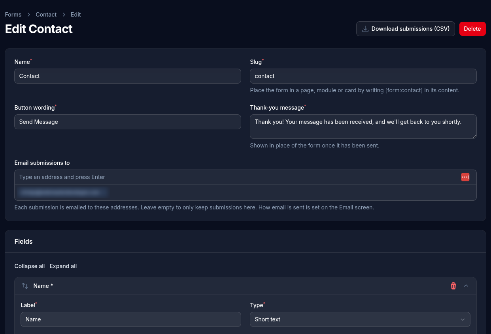

# Forms

Forms are built here and placed in a page, post, card or module with `[form:slug]`. Every site starts with a **Contact** form and a **Newsletter** form (which just collects email addresses).

## Building a form

- **Name** and **Slug**: the slug is used in the shortcode.
- **Button wording**: the text on the send button, such as "Send Message".
- **Thank-you message**: shown in place of the form once it has been sent.
- **Email submissions to**: one or more addresses that each submission is emailed to. Leave it empty to only keep submissions in the admin. How email is sent is set on the [Email](email.md) screen.
- **Fields**: add as many as you need, and drag them into order. Each has:
  - a **label** and a **type**: Short text, Long text, Email address, Phone number, Number, Date, Dropdown, Checkboxes or Radio buttons
  - **choices**, for dropdowns, checkboxes and radio buttons
  - optional **help text** shown under the field
  - whether it's **required**

File uploads aren't offered.

## Submissions

Everything sent with a form is stored, whether or not the email went out. Open a form to see its **submissions**: each one's answers, when it was sent, and whether it was emailed. **Download CSV** gives a spreadsheet of them all. The newest submissions from every form are also on the Dashboard.

## Spam

Every form has a hidden field that only spam robots fill in: they're shown the thank-you message, but nothing is kept or emailed. A visitor can also send the same form at most 5 times a minute.
