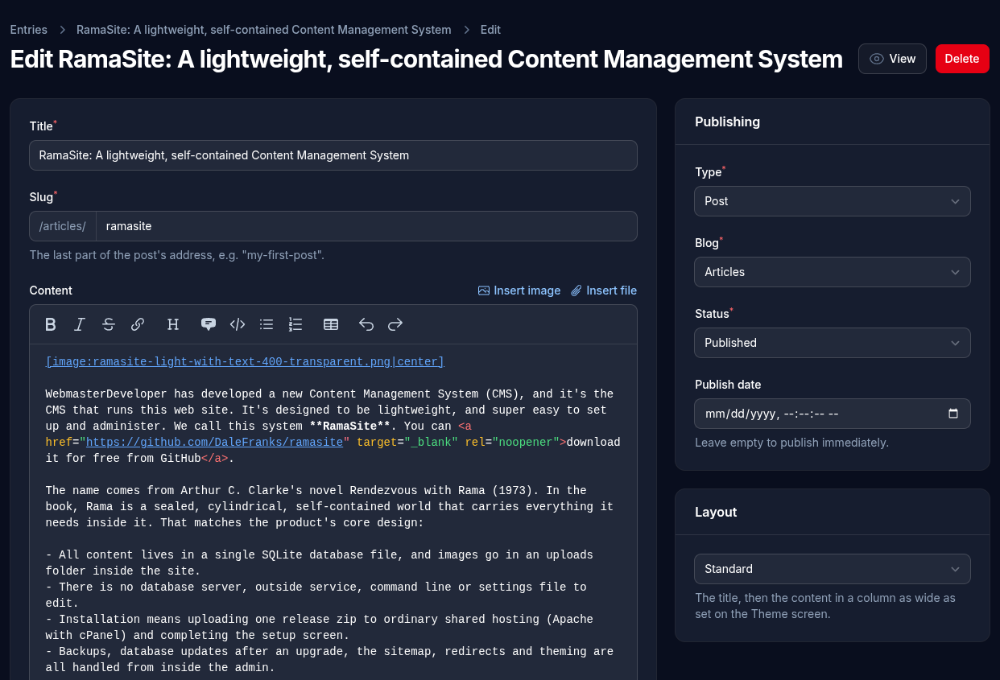

# Pages & Posts

Everything with its own address on the site is listed here. There are three types:

- **Page**: an ordinary page, such as About or Contact
- **Blog**: a page that lists its posts, newest first (a site can have several blogs)
- **Post**: an article that belongs to one blog. Its address is the blog's followed by its own, such as `/articles/my-first-post`

## Writing a page or post

- **Title**: shown at the top of the page and in the browser tab.
- **Slug**: the page's address. It's filled in from the title as you type, and numbered if that address is taken (`about-2`). Pages and blogs can use slashes to sit "under" another address, such as `services/design`. A post's slug is just its own part.
- **Content**: written in Markdown, with shortcodes. See [Writing content](writing-content.md).
- **Search engines & sharing**:
  - an optional **description** and **keywords**. The description is often shown under the page's title in search results, and in link previews on social media.
  - **Featured image**: the picture shown when the page is shared on social media (Facebook, LinkedIn, X and others), and, for a post, on its card in the blog's list. Choose from the images in the page's own content; images in cards, modules and sliders placed on the page aren't offered. Left empty, the first image in the content is used, and a page with no images uses the logo. If the chosen image is later taken out of the content, the first image is used instead.

Social media sites remember a link's preview once they've seen it. After changing a page's featured image, use Facebook's [Sharing Debugger](https://developers.facebook.com/tools/debug/) (paste the link and click **Scrape Again**) to refresh it there.

The page with the slug **`home`** is the home page, shown at the site's main address. So the main address always has a page, its slug and type can't be changed and it can't be deleted. It can still be set to Draft, but visitors to the main address then see "Page not found".

Some addresses are used by the CMS itself and can't be taken: `admin`, `setup`, `uploads`, `forms` and a few others. Neither can `css`, `fonts` and `js`, which are folders the web server answers itself.

## Publishing

- **Status**: **Draft** pages are hidden from visitors; **Published** ones are on the site.
- **Publish date**: leave it empty to publish straight away; it's filled in with the moment the page or post is first published. A date in the future schedules it: it appears on its own at that time. Dates are entered and shown in the site's timezone, set on the [Theme](theme.md) screen.
- **Show the publish date**: whether the date appears under the title on the site, and for a post, in its blog's list. It starts on for posts and off for pages and blogs, and can be switched either way.

### Previewing

**Preview**, at the top of a page's edit screen, opens the page in a new tab as it was last saved, so save first to see your latest changes. It works for drafts, scheduled pages and posts, and posts in a blog that isn't published yet. A bar at the bottom says why visitors can't see the page yet, with a link back to edit it. Only someone signed in to the admin can open a preview; visitors get the "not found" page, as before. Previews are left out of search engines, the menu and the blog's list of posts.

Once a page is on the site, the same button says **View**. The eye icon beside **Edit** in the list of pages and posts does the same.

When a published page's address changes (its slug, or its blog's), a [redirect](redirects.md) from the old address is added automatically, so links and search results keep working.

## Layout

- **Standard**: the title, then the content in a column as wide as set on the Theme screen.
- **Full width**: the title, then the content as wide as the header.
- **Landing**: modules stretch across the whole window as bands. The title is hidden unless **Show title** is switched on, so start the page with a slider or a module that has its own heading. When hidden, the title is still there for search engines and screen readers. With **Show title** on, it shows above the content in the text column, as on other layouts.

## The menu

Pages and blogs can appear in the menu at the top of every page (posts can't):

- **Menu order**: a number; lower numbers come first. Leave it empty to keep the page out of the menu.
- **Parent**: put the page in a dropdown under another menu item.
- **Menu label**: a shorter name for the menu, if the title is long.

When the menu doesn't fit beside the logo (and always on phones), it folds into a menu button.

## Blogs

A blog's page shows its own content first, then its published posts as cards: each post's featured image (or else its first image), its title, date, and the first three sentences.

- **Posts per page** (in the Blog box): how many posts are listed before going on to a next page. It starts at 9, which fills three rows of three.
- **Columns** (in the Blog box): how the cards are arranged. **Automatic**, the starting choice, fits as many columns as the window has room for. You can instead choose 1, 2 or 3 columns. On smaller screens, 3 columns become 2, and phones always show 1.

### RSS feed

Every published blog has an RSS feed at its address followed by `/feed.xml`, such as `/articles/feed.xml`, for feed readers and services that pass new posts on (by email, for example). It lists the 20 newest published posts, each with its title, date, featured image and first three sentences, linking to the post for the rest. The feed's description is the blog's **Meta description** (under Search engines & sharing). There's nothing to set up, and every page tells browsers and feed readers where the feeds are.

A blog that has posts can't be deleted or changed to another type; move or delete its posts first.
