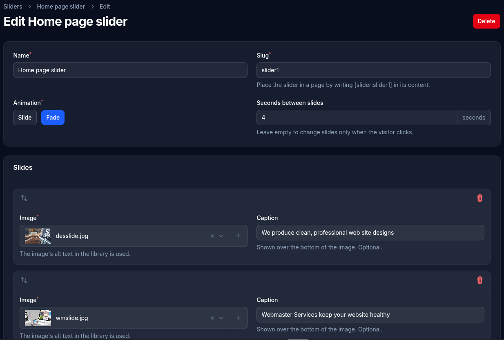

# Sliders

A slider shows a series of images one at a time, with arrows to move between them. Place one in a page with `[slider:slug]`.

- **Name** and **Slug**: the slug is used in the shortcode.
- **Animation**: **Slide** (images move sideways) or **Fade** (each image fades into the next).
- **Seconds between slides**: how long each image shows before the next. Leave it empty to change slides only when the visitor clicks.
- **Arrow style**: Square (the starting choice), Circle, Outline circle, Bare chevron, Long arrow or Solid triangle.
- **Arrow and dot color**: the color of the arrows and the dots. Leave it empty to use the Theme screen's color.
- **Arrow backing color**: for Square and Circle only, the color behind the arrow. It's shown see-through, and more solid when pointed at. Leave it empty to use the Theme screen's color.
- **Edge to edge on Landing pages**: on a page with the Landing layout, the slider runs the full width of the window, stacked between modules like a band and touching them. On other layouts it fills the content column as usual. Use images at least 1920 pixels wide. The image fills the width at its own shape, so its height follows from its proportions. After saving, a notice names any images under 1920 pixels wide and tells you if the slides aren't all the same shape, but the slider saves either way.
- **Slides**: add an image to each slide, either picked from the [image library](images.md) or uploaded on the spot (it's added to the library). Drag slides to change their order.
  - **Caption**: optional text shown over the image. Line breaks are kept.
  - **Slow zoom**: Off (the starting choice), Zoom in or Zoom out. The image gently zooms by about 12% for as long as the slide shows and on through the change to the next one, while the caption stays still. On a slider with no timer, it runs once for about 8 seconds and holds. Visitors whose device asks for reduced motion don't see it.
  - **Text position**: a banner at the bottom (the starting choice) or top, or a box about 40% wide at the left or right, centered vertically. On phones, a box at the side becomes a banner at the bottom.
  - **Text color** and **Background color**: leave them empty for white text on black at 65%.
  - The image's alt text in the library is used for screen readers.

An image used in a slider can't be deleted from the library until it's removed from the slider. The site-wide arrow colors and animation speed can be adjusted on the Theme screen's **Slider** tab.
