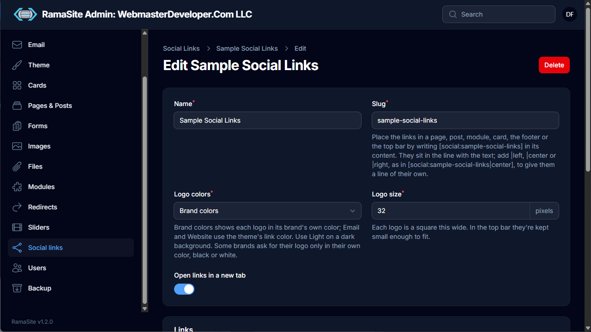
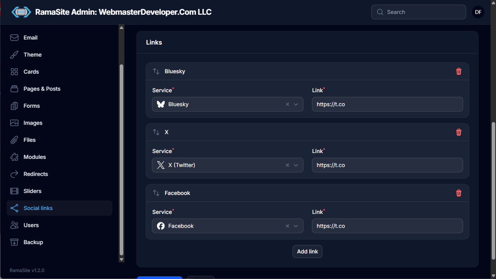

# Social links

A set of social links is a row of logos, each linking to one of your profiles, such as your Facebook page or Instagram account. Sets are built here and placed with `[social:slug]` in a page, post, card, module, the footer or the [top bar](theme.md). A new site has none; add a set when you need one. A site can have several sets, such as small dark logos for the top bar and larger ones for the footer.

## Building a set



- **Name** and **Slug**: the slug is used in the shortcode. While a page, post, card, module, the footer or the top bar places the set, it can't be deleted and its slug can't change; the message says where it's used, so those can be changed first.
- **Logo colors**:
  - **Brand colors**: each logo in its brand's own color, such as Facebook's blue. Email and Website have no brand, so they use the theme's link color. Some brands' color is black (X, Threads, TikTok, GitHub, Medium and Patreon), and Snapchat's yellow is hard to see on white, so on some backgrounds another choice looks better.
  - **Dark**: every logo in near-black, for a light background.
  - **Light (white)**: every logo in white, for a dark background such as a Dark footer or top bar.
  - **Custom color**: every logo in a color you choose. Some brands ask for their logo only in their own color, black or white.
- **Logo size**: each logo is a square this many pixels wide, from 24 to 128. In the top bar the logos are kept small enough to fit the bar.
- **Open links in a new tab**: on by default. Email links always open the visitor's email program instead.
- **Links**: add one line for each profile, and drag them into order. Each has a **service**, which sets its logo, and the **link** to your profile, starting with `https://`. For **Email**, enter just the email address; it becomes a link that starts an email to you.



Screen readers announce each logo by its service's name, such as "Facebook".

## Services

Behance, Bluesky, Discord, Dribbble, Email, Etsy, Facebook, GitHub, Google Business Profile, Instagram, LinkedIn, Mastodon, Medium, Nextdoor, Patreon, Pinterest, Reddit, RSS feed, Snapchat, SoundCloud, Spotify, Substack, Telegram, Threads, TikTok, Tripadvisor, Twitch, Vimeo, Website, WhatsApp, X, Yelp and YouTube.

Their logos are built in, so each one is the brand's own logo. Logos can't be uploaded, except LinkedIn's.

### LinkedIn

LinkedIn only allows its official logo, downloaded from LinkedIn, so it can't be built in like the others. To add a LinkedIn link:

1. Download the logo from [brand.linkedin.com/downloads](https://brand.linkedin.com/downloads). (Downloading it means you accept LinkedIn's brand rules.)
2. Choose the blue, black or white version, whichever shows up best against the background where these links will appear.
3. Upload it on the [Images](images.md) screen, then pick it as the **LinkedIn logo** on the link's line.

LinkedIn allows only its own colors and doesn't allow the logo to be changed, so the set's logo colors don't apply to it: it's shown exactly as uploaded, at the set's size. While a set uses the image, it can't be deleted from the image library.

## Placing a set

```
Follow us: [social:main]
[social:main|center]
```

- `[social:slug]` places the logos in the line, with any text around them.
- `[social:slug|left]`, `[social:slug|center]` or `[social:slug|right]` puts them on a line of their own, at the left, center or right.

The logos never wrap onto a second line, so keep a set short enough for the space it's placed in, especially on phones.

In the top bar, the logos sit in the line with the text. Choose the top bar's **Spread** alignment on the [Theme](theme.md) screen to put the text at the left and the logos at the right.

The logos and brand colors come from [Simple Icons](https://simpleicons.org), which is free to use. The logos are trademarks of their owners.
