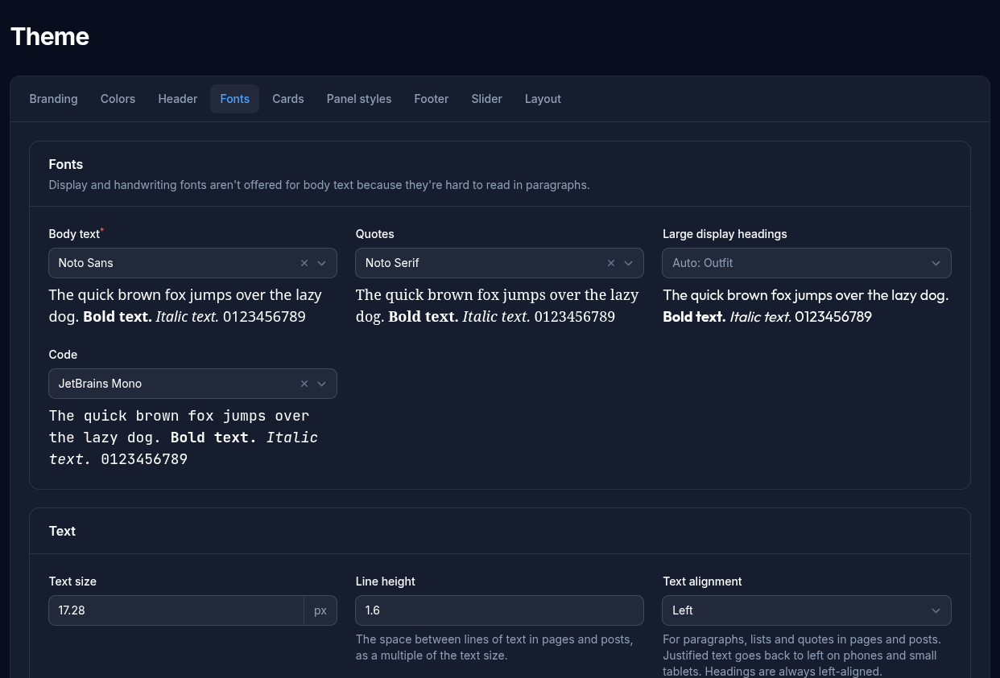
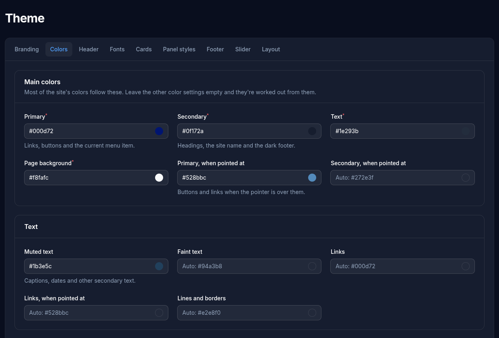

# Theme

The Theme screen sets how the whole site looks. There's no template code to edit.

Most settings start **empty, meaning automatic**: their value is worked out from the main colors and fonts, and the grey "Auto: …" text in each box shows what that currently is. Type a value to override just that setting; clear it to go back to automatic. So a site looks right with only the main settings chosen.

**Reset to defaults** puts everything back to the original look and removes the logo and tab icon. It keeps the site name, the timezone and the top bar's text.

If the settings have changed since you opened the screen, in another browser tab or by another admin, **Save** stops and asks what to do. **Load the latest settings** discards what you've changed on this screen. **Save my version anyway** replaces everything with what's on this screen.

## Tabs

**Branding**
- **Site name**: shown in the header (unless hidden), in browser tabs ("Page | Site name"), as the logo's description, and as the "From" name on email.
- **Timezone**: publish dates are entered in this timezone, and dates on the site, in the admin and in form emails are shown in it. It starts as UTC; choose your own, such as America/Los_Angeles for Pacific time. Changing it never moves when a scheduled page appears, but check the times of any already-scheduled pages afterwards, because they'll now show in the new timezone.
- **Logo** and **Browser tab icon** (a small square image).
- Logo height, maximum width, and whether it tilts slightly when pointed at.

**Colors**
- The four main colors: **Primary** (links, buttons, the current menu item), **Secondary** (headings, the site name, the dark footer), **Text** and **Page background**.
- Detailed colors for hover states, muted text, links, borders and code.

**Header**
- **Layout**: logo on the left with the menu beside it, or centered with the menu below; whether the header stays visible while scrolling; and the **site name** beside the logo, below it, or not shown (logo only). The site name can also hide once the visitor scrolls down.
- **Top bar**: an optional line of text in a thin bar above the logo and menu, such as a phone number. It never takes room from the menu.
  - **Text**: one line. Markdown works, so `[(760) 555-0100](tel:+17605550100)` is a number visitors can tap to call. Leave it empty for no bar.
  - **Style** (Dark, Light or Primary color), **Alignment**, **Font** and **Text size**. The bar grows to fit the text size.
  - **Keep the top bar visible when scrolled**: when off, the bar folds away as the header shrinks, and comes back at the top of the page.
- **Header bar**: background color, menu link colors, the header's height at the top of the page and once scrolled, and an optional background image.
- **Menu on phones**: the colors of the menu that opens from the menu button.

**Fonts**
- The body and heading fonts, plus fonts for quotes, large display headings and code, chosen from a list of Google Fonts grouped by type. Type in a list to search it. A sample of the chosen font appears beneath each list. Display and handwriting fonts aren't offered for body text. Fonts load from Google; a site doesn't keep font files of its own.
- **Text size** for body text.
- **Text alignment**: **Left** or **Justified**, for paragraphs, lists and quotes in pages and posts. Justified text goes back to left on phones and small tablets. Headings are always left-aligned, and tables, cards and modules aren't affected.
- **Line height**: the space between lines of text in pages and posts, as a multiple of the text size. It starts at 1.6, and clearing the box puts 1.6 back. Anything inside a page's content follows it unless it has spacing of its own, such as headings. The site's header, menu and footer don't.
- **Headings**: the font, size, weight, color and line height of Heading 1 and page titles, which every other heading level follows by default. Heading 2 to Heading 6 can each have their own font, size, weight and color, and line height is shared by all of them. A font without the chosen weight uses its closest one. Headings in Dark, Light and Primary color panels and in cards keep their own look. Until a Heading 1 size or line height is chosen, page titles stay at 40 px and 1.15.

**Cards**: card title and text colors and sizes.

**Panel styles**: the colors of the **Dark**, **Light** and **Primary** styles that cards, modules and the top bar can use.

**Footer**: the footer's style (Dark, Light or Primary color), alignment, text size and spacing, its colors, and a button to edit what the footer says.

**Slider**: the colors of the arrows and dots, and how long the slide and fade animations take.

**Layout**
- **Text width**: how wide the content column is on Standard pages.
- **Corner roundness** of cards, panels and images.
- **Custom CSS**: for anything the settings don't cover.
