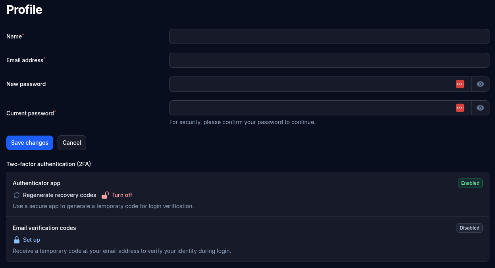

# Users and security

## Users

Everyone who can log in to the admin is listed on the **Users** screen. Every account is an admin, with access to everything.

- **New user**: a name, an email address (used to log in) and a password of at least 8 characters, typed twice. Give the new admin their password privately; they can change it on their profile.
- **Edit**: change someone's name or email, or give them a new password if they've forgotten theirs. Leave the password empty to keep their current one.
- **Delete**: removes someone's access. Pages they wrote are kept. You can't delete your own account, so the site always has at least one admin.
- **Two-step login** shows who has it turned on. **Turn off two-step login** is for someone who has lost their phone or can't get the emailed codes; they can turn it back on from their profile.

## Your profile

Click your initial in the top-right corner and choose **Profile** to change your name, email address or password. A new password is only saved if you also enter your current one.

## Two-step login

Two-step login asks for a code as well as your password, so a stolen or guessed password isn't enough to get in. Each admin chooses whether to use it, on their profile:

- **Authenticator app**: scan the QR code with an app such as Google Authenticator or Microsoft Authenticator, and enter the 6-digit code it shows. You're also given **recovery codes**: keep them somewhere safe, since each one lets you in once if you lose your phone.
- **Email verification codes**: a code is emailed to you each time you log in. This needs the site's [email](email.md) to be working.

If you're locked out, another admin can turn off your two-step login on the Users screen.

## Forgotten passwords

**Forgot password?** on the login screen emails a link for choosing a new password. The link works for 60 minutes. This needs the site's email to be working; if it isn't, another admin can set a new password for you on the Users screen.

## Built-in protection

- Setup can only be finished by someone who can read the `setup-key.txt` file in the site's folder, so a stranger who finds a newly uploaded site can't make themselves the admin.
- Login allows 5 attempts a minute, and password reset requests 2 a minute. These count visitors by their internet address, so behind Cloudflare, admins coming through the same Cloudflare server share them (see [Sites behind Cloudflare](forms.md#sites-behind-cloudflare)).
- On a site whose address starts with `https://`, every `http://` visit is sent to `https://`, and the login cookie is only ever sent over HTTPS. (This follows the address setup was finished on. The setup screen moves to `https://` by itself when the site has a working certificate.)
- Admin sessions end after 2 hours without activity, unless **Remember me** was ticked. Changing your password logs out your other sessions.
- Browsers are told not to show the site inside other websites' frames.
- Only images can be uploaded, and nothing in the uploads folder can run as a program.
- The site's settings file, database and code can't be reached from a browser.
